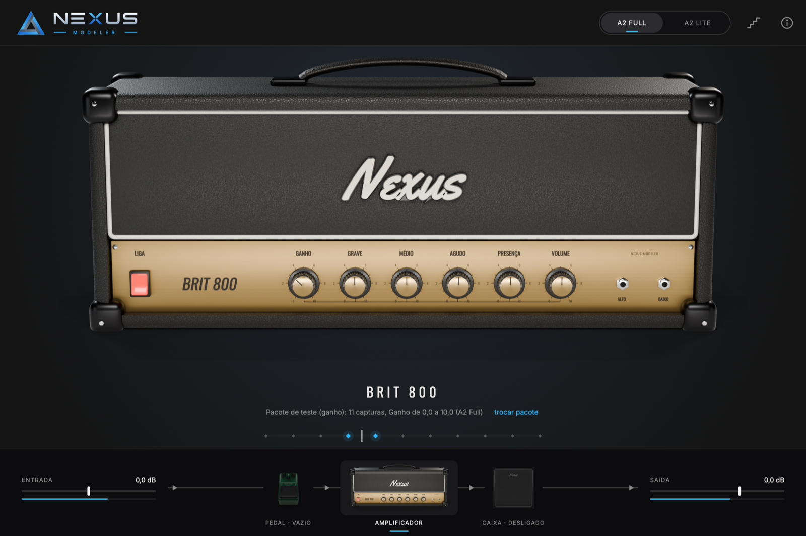
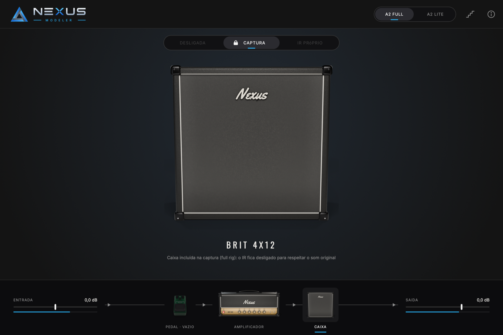
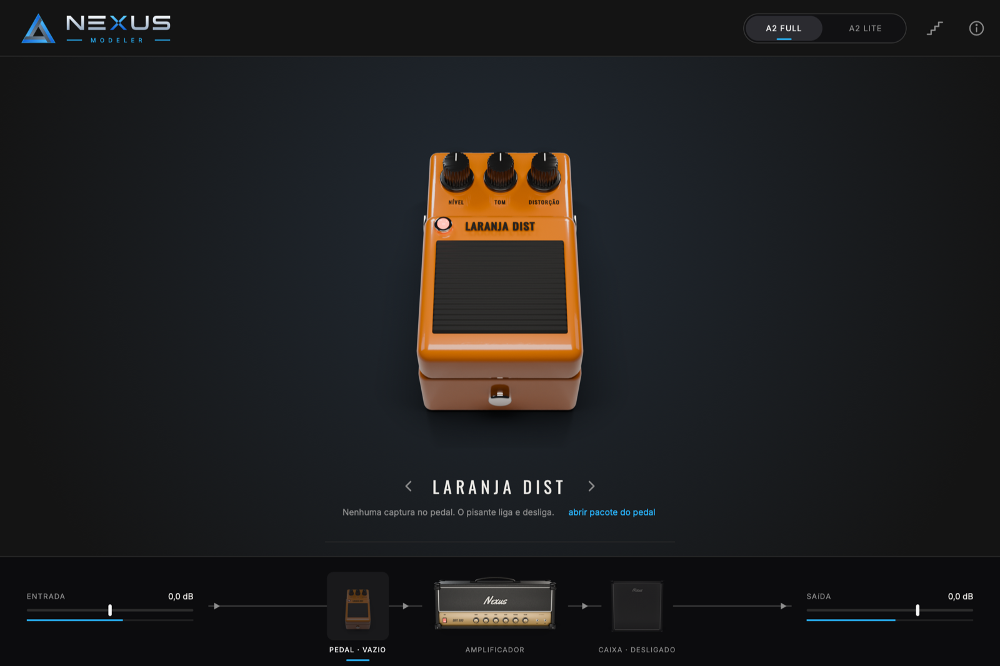

# Nexus Modeler

**A qualidade da captura com a facilidade da modelagem.**

Plugin de guitarra gratuito e de código aberto para Windows, Mac e Linux.

Hoje o guitarrista escolhe entre dois mundos:

- a **modelagem** de amplificador: você gira os botões e timbra à vontade, mas
  o som é uma simulação;
- a **captura**: o som real de um equipamento, mas congelado no ajuste em que
  foi gravado. Para mudar o timbre, você troca de arquivo.

O Nexus Modeler une os dois. Ele traz para o mundo da captura a facilidade de
timbragem da modelagem, sem abrir mão da qualidade que a captura tem.

Na prática:

- **O botão troca a captura.** Quem clona um amplificador publica um pacote
  com várias capturas (ganho 0, 1, 2… até 10). No Nexus, você gira o ganho do
  cabeçote, ou o drive do pedal, e ele carrega a captura daquela posição por
  dentro, sem clique no som e sem abrir pasta nenhuma.
- **O equalizador do painel funciona como no amplificador real.** Ele é
  modelado no circuito de tonalidade de cada família de amplificador e aplica
  só a diferença para a posição em que a captura foi feita. Com os botões
  nessa posição, o som é exatamente o da captura.
- **Canais, pedais e caixa como num equipamento de verdade.** Um cabeçote de
  até 3 canais, como o original, com uma captura por canal. Pedais com drive
  em estágios, que também trocam de captura. A caixa respeita a captura full
  rig.

Tudo isso toca capturas do
[Neural Amp Modeler](https://github.com/sdatkinson/NeuralAmpModelerCore)
(NAM A2 Full e A2 Lite).

> **Estado atual (em desenvolvimento, ainda sem versão publicada).** Já
> funcionam o motor de troca de capturas, o equalizador do painel, a tela com
> o amplificador Brit 800, a caixa 4x12 e três pedais renderizados em 3D, a
> caixa com IR próprio que se tranca sozinha em capturas full rig e o pedal
> tocando capturas antes do amplificador. A importação direta da TONE3000 e o
> player de estudo estão no plano
> ([ARQUITETURA.md](ARQUITETURA.md) e [docs/MODELOS-3D.md](docs/MODELOS-3D.md)).



*Com o ganho em 3,5, as capturas 3 e 4 tocam juntas, metade cada uma: os dois
losangos acesos no trilho embaixo do nome.*



*Captura full rig (cabeçote + caixa): a caixa fica trancada em "Captura" e o
IR não toca, para respeitar o som original.*



*Pedal antes do amplificador: três visuais (Lemon Drive, Laranja Dist e Ouro),
trocados pelas setas ao lado do nome; o pisante liga e desliga.*

## O que a prova do motor já faz

- **Troca de captura sem clique.** A captura que vai entrar primeiro "aquece"
  ouvindo o som recente da guitarra e só depois entra numa transição de 30 ms.
- **Botão contínuo ou em degraus.** Contínuo mistura as vizinhas; em degraus,
  o botão só para nas posições que têm captura.
- **Equalizador do painel** (grave, médio, agudo e presença) modelado no
  circuito de tonalidade do amplificador real. Ele aplica só a diferença entre
  a posição em que a captura foi feita e a posição escolhida. Com os botões na
  posição da captura, o som é exatamente o da captura.
- **A2 Full e A2 Lite** com um botão (o mesmo arquivo serve para os dois).
- **Qualquer taxa de amostragem.** As capturas rodam a 48 kHz; se o programa de
  gravação estiver em 44,1 ou 96 kHz, o plugin converte na entrada e na saída.
- **Formatos:** VST3 (Windows, Mac e Linux), AU (Mac), LV2 (Linux) e programa
  independente, sem precisar de programa de gravação.
- **Caixa (IR):** abas Desligada / Captura / IR próprio. Escolha um `.wav` de
  resposta de caixa; a troca entra e sai em 30 ms, sem estalo. Se a captura
  inclui a caixa (o `.nam` diz `amp_cab`, ou o `pack.json` traz
  `"inclui_caixa": true`), a caixa se tranca em "Captura".
- **Pedal:** um bloco antes do amplificador que toca captura NAM de pedal (e
  também pacote de ganho, com troca sem clique). Ganho, Tom e Nível; clique no
  pisante liga e desliga em 20 ms, sem estalo. Três visuais: Lemon Drive,
  Laranja Dist e Ouro.
- **Programa independente com interfaces de áudio de baixa latência:** ASIO,
  WASAPI e DirectSound no Windows, Core Audio no Mac, JACK e ALSA no Linux.
  O painel de áudio (ícone da interface na barra de cima) escolhe interface,
  entrada da guitarra, saídas, taxa e buffer, e mostra a latência de ida e
  volta, o uso do processador e o sinal da guitarra.
- **MIDI por USB e Bluetooth:** troca de patch 1, 2, 3 escolhe o canal do
  cabeçote; qualquer controle da pedaleira (CC) pode ser ligado a qualquer
  botão, ao pisante do pedal ou ao canal: clique com o botão direito e
  "Aprender MIDI". No programa independente os dispositivos MIDI abrem
  sozinhos; no Mac há um botão para parear MIDI por Bluetooth; no Windows e no
  Linux, pareie nos ajustes de Bluetooth do sistema.
- **Cabeçote de até 3 canais, como o original:** cada canal tem o próprio
  pacote de capturas e o próprio ganho; a troca é sem estalo e o canal parado
  não gasta processador. Amplificador de um canal (o Brit 800) não mostra
  seletor.
- **15 idiomas:** português (Brasil), inglês, espanhol, francês, italiano,
  alemão, japonês, chinês, coreano, hindi, árabe, bengali, russo, indonésio e
  turco. O globo na barra de cima troca o idioma; na primeira vez vale o do
  sistema. Os nomes dos botões (GANHO, GRAVE…) são caixas de texto por cima da
  imagem 3D, traduzidas sem precisar renderizar de novo. O pacote de idiomas
  fica em `assets/idiomas/` e é gerado por `tools/idiomas/traducoes.py`.
- **Tela 3D:** amplificador, caixa e pedais modelados e renderizados pelo Nexus Gear
  Studio (`tools/gear_studio`). Cada botão tem 101 imagens: arraste para cima
  ou para baixo, Shift para ajuste fino, duplo clique volta ao padrão.

## Medidas

A ferramenta `nexus_bench` prova o motor com números, e `nexus_host_test` abre
o plugin compilado como um programa de gravação faria. Resultado num Mac Intel
Core i9 (2019):

| Verificação | Resultado |
|---|---|
| Fórmula do equalizador contra a análise do circuito (Marshall, Fender, alto ganho) | diferença máxima 0,000 dB |
| Equalizador na posição da captura | saída idêntica à entrada |
| Capturas iguais com o botão andando, comparadas a uma captura parada | diferença −311 dB (zero na prática): o aquecimento não deixa resto |
| Clique na troca (varredura, saltos, vaivém rápido, degraus) | nenhum excesso de aspereza; a troca seca, para comparação, dá +8,6 dB |
| Clique ao saltar grave, médio, agudo e presença de 0 a 10 | nenhum |
| Memória reservada durante o áudio | zero |
| Uso do processador por captura A2 Full / A2 Lite | 9,3 % / 1,4 % de um núcleo |
| Bloco de 128 amostras varrendo o ganho (3 capturas ativas) | 1,3 ms dos 2,7 ms disponíveis |
| Plugin aberto a 44,1, 48 e 96 kHz | carrega, toca e mantém o volume (diferença até 0,31 dB) |
| Captura full rig com IR ligado | o som não muda (diferença −300 dB): caixa trancada |
| Captura de cabeçote com IR | o IR muda o som, como deve |
| Pedal desligado | som idêntico ao de sem pedal (−300 dB) |
| Desligar o pedal tocando | sem salto no som (transição de 20 ms) |
| Tela: arrastar, Shift, duplo clique, trocar de peça, pisante | testado simulando o mouse |
| Interface de áudio real (Realtek USB, Mac) a 48 kHz | zero falhas de áudio; ida e volta 6,5 ms (32 amostras), 7,8 ms (64), 10,5 ms (128) |
| Trocar de canal tocando | sem salto; canal vazio é ignorado |
| MIDI: troca de patch, aprender CC, liga/desliga, salvar | tudo confere |
| Validador de plugins (pluginval, nível 5) | roda na compilação automática nos três sistemas |

## Como usar o pacote de capturas

1. Coloque as capturas `.nam` de um mesmo equipamento numa pasta.
2. Dê nomes com o número da posição: `Ganho 0.nam`, `JCM800 Gain 7.nam`,
   `G07.nam`, `drive_7.5.nam`… O Nexus encontra o número sozinho.
3. Ou crie um `pack.json` na pasta, que tem prioridade sobre os nomes:

```json
{
  "nome": "Brit 800",
  "botao": "Ganho",
  "circuito": "marshall",
  "equalizador_da_captura": { "grave": 5, "medio": 5, "agudo": 5, "presenca": 5 },
  "capturas": { "0": "ganho0.nam", "5": "ganho5.nam", "10": "ganho10.nam" }
}
```

Circuitos de equalizador disponíveis: `marshall`, `fender`, `alto_ganho`,
`mesa_mark`. Os valores de alto ganho e do Mark ainda serão conferidos família
por família.

4. No plugin, clique em **abrir pacote**, embaixo do nome do amplificador, e
   escolha a pasta. Para o pedal, clique no pedal no caminho do sinal e depois
   em **abrir pacote do pedal**: o pacote do pedal segue as mesmas regras (o
   botão Ganho do pedal troca as capturas).

## Como instalar

Os instaladores chegam na primeira versão publicada: `.exe` no Windows, `.dmg`
no Mac, `.deb` no Linux e instalação por um comando no terminal. Até lá, dá
para compilar (abaixo) ou baixar o que a compilação automática gera na aba
**Actions**.

## Como compilar

Precisa de CMake 3.24 ou mais novo, Git, Python 3 e um compilador C++20
(Xcode no Mac, Visual Studio 2022 no Windows, GCC ou Clang no Linux). O JUCE é
baixado sozinho na primeira configuração.

```bash
git clone --recursive https://github.com/disouz4-dev/Nexus-Modeler.git
```

```bash
cmake -S Nexus-Modeler -B Nexus-Modeler/build -DCMAKE_BUILD_TYPE=Release
```

```bash
cmake --build Nexus-Modeler/build --config Release
```

```bash
ctest --test-dir Nexus-Modeler/build -C Release --output-on-failure
```

Os plugins ficam em `build/plugin/NexusModeler_artefacts/Release/`. No Linux,
instale antes as bibliotecas de desenvolvimento listadas em
`.github/workflows/compilacao.yml`.

A cada envio ao GitHub, a compilação automática gera e testa o plugin nos três
sistemas e guarda os arquivos compilados na aba **Actions**.

## Organização

```
engine/     motor: troca de capturas, equalizadores, leitura dos pacotes
plugin/     plugin JUCE (tela e caixa) e testes do plugin aberto
tools/      medidor do motor, pacotes de teste e o Nexus Gear Studio (3D)
assets/     imagens 3D renderizadas e fontes, embutidas no plugin
external/   motor oficial do NAM (submódulo)
docs/       famílias de modelos 3D e ferramenta de criação
```

## Novidades

O que mudou em cada versão está em [NOTAS-DE-VERSAO.md](NOTAS-DE-VERSAO.md).

## Licença

Nexus Modeler é software livre sob a licença **GPL versão 3** (veja
[LICENSE](LICENSE)). Os componentes de terceiros e as licenças deles estão em
[TERCEIROS.md](TERCEIROS.md).

Os nomes de marcas de amplificadores citados neste repositório pertencem aos
seus donos e aparecem só como referência. O Nexus Modeler não tem ligação com
eles.
