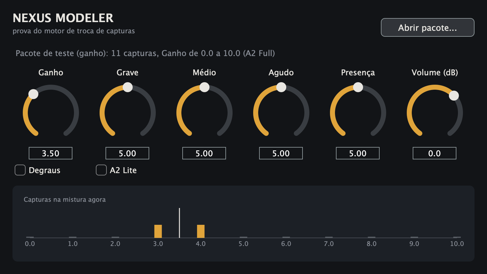

# Nexus Modeler

Plugin de guitarra gratuito e de código aberto para Windows, Mac e Linux que
toca capturas do [Neural Amp Modeler](https://github.com/sdatkinson/NeuralAmpModelerCore)
(NAM A2 Full e A2 Lite) como se fossem equipamentos de verdade.

Quem clona um amplificador costuma publicar um **pacote** com várias capturas:
ganho 0, ganho 1, ganho 2… até 10. Hoje, para mudar o ganho, é preciso abrir a
pasta e trocar o arquivo na mão. No Nexus Modeler, você gira o botão de ganho e
o plugin troca de captura por dentro, sem clique no som. Entre duas posições
(ganho 2,5, por exemplo) ele mistura as duas capturas vizinhas.

> **Estado atual: prova do motor (versão 0.1.0).** Já funcionam o motor de
> troca de capturas, o equalizador do painel e o plugin com uma tela
> provisória. A tela 3D, a importação direta da TONE3000, os pedais, as caixas
> e o player de estudo estão no plano ([ARQUITETURA.md](ARQUITETURA.md) e
> [docs/MODELOS-3D.md](docs/MODELOS-3D.md)).



*Com o ganho em 3,5, as capturas 3 e 4 tocam juntas, metade cada uma.*

## O que a prova do motor já faz

- **Troca de captura sem clique.** A captura que vai entrar primeiro "aquece"
  ouvindo o som recente da guitarra e só depois entra numa transição de 30 ms.
- **Botão contínuo ou em degraus.** Contínuo mistura as vizinhas; em degraus,
  o botão só para nas posições que têm captura.
- **Equalizador do painel** (grave, médio, agudo e presença) modelado no
  circuito de tonalidade do amplificador real. Ele aplica só a diferença entre
  a posição em que a captura foi feita e a posição escolhida. Com os botões na
  posição da captura, o som é exatamente o da captura.
- **A2 Full e A2 Lite** com um botão (o mesmo arquivo serve para os dois).
- **Qualquer taxa de amostragem.** As capturas rodam a 48 kHz; se o programa de
  gravação estiver em 44,1 ou 96 kHz, o plugin converte na entrada e na saída.
- **Formatos:** VST3 (Windows, Mac e Linux), AU (Mac), LV2 (Linux) e programa
  independente, sem precisar de programa de gravação.

## Medidas

A ferramenta `nexus_bench` prova o motor com números, e `nexus_host_test` abre
o plugin compilado como um programa de gravação faria. Resultado num Mac Intel
Core i9 (2019):

| Verificação | Resultado |
|---|---|
| Fórmula do equalizador contra a análise do circuito (Marshall, Fender, alto ganho) | diferença máxima 0,000 dB |
| Equalizador na posição da captura | saída idêntica à entrada |
| Capturas iguais com o botão andando, comparadas a uma captura parada | diferença −311 dB (zero na prática): o aquecimento não deixa resto |
| Clique na troca (varredura, saltos, vaivém rápido, degraus) | nenhum excesso de aspereza; a troca seca, para comparação, dá +8,6 dB |
| Clique ao saltar grave, médio, agudo e presença de 0 a 10 | nenhum |
| Memória reservada durante o áudio | zero |
| Uso do processador por captura A2 Full / A2 Lite | 9,3 % / 1,4 % de um núcleo |
| Bloco de 128 amostras varrendo o ganho (3 capturas ativas) | 1,3 ms dos 2,7 ms disponíveis |
| Plugin aberto a 44,1, 48 e 96 kHz | carrega, toca e mantém o volume (diferença até 0,31 dB) |

## Como usar o pacote de capturas

1. Coloque as capturas `.nam` de um mesmo equipamento numa pasta.
2. Dê nomes com o número da posição: `Ganho 0.nam`, `JCM800 Gain 7.nam`,
   `G07.nam`, `drive_7.5.nam`… O Nexus encontra o número sozinho.
3. Ou crie um `pack.json` na pasta, que tem prioridade sobre os nomes:

```json
{
  "nome": "Brit 800",
  "botao": "Ganho",
  "circuito": "marshall",
  "equalizador_da_captura": { "grave": 5, "medio": 5, "agudo": 5, "presenca": 5 },
  "capturas": { "0": "ganho0.nam", "5": "ganho5.nam", "10": "ganho10.nam" }
}
```

Circuitos de equalizador disponíveis: `marshall`, `fender`, `alto_ganho`,
`mesa_mark`. Os valores de alto ganho e do Mark ainda serão conferidos família
por família.

4. No plugin, clique em **Abrir pacote…** e escolha a pasta.

## Como compilar

Precisa de CMake 3.24 ou mais novo, Git, Python 3 e um compilador C++20
(Xcode no Mac, Visual Studio 2022 no Windows, GCC ou Clang no Linux). O JUCE é
baixado sozinho na primeira configuração.

```bash
git clone --recursive https://github.com/disouz4-dev/Nexus-Modeler.git
```

```bash
cmake -S Nexus-Modeler -B Nexus-Modeler/build -DCMAKE_BUILD_TYPE=Release
```

```bash
cmake --build Nexus-Modeler/build --config Release
```

```bash
ctest --test-dir Nexus-Modeler/build -C Release --output-on-failure
```

Os plugins ficam em `build/plugin/NexusModeler_artefacts/Release/`. No Linux,
instale antes as bibliotecas de desenvolvimento listadas em
`.github/workflows/compilacao.yml`.

A cada envio ao GitHub, a compilação automática gera e testa o plugin nos três
sistemas e guarda os arquivos compilados na aba **Actions**.

## Organização

```
engine/     motor: troca de capturas, equalizadores, leitura dos pacotes
plugin/     plugin JUCE (tela provisória) e testes do plugin aberto
tools/      medidor do motor e gerador dos pacotes de teste
external/   motor oficial do NAM (submódulo)
docs/       famílias de modelos 3D e ferramenta de criação
```

## Licença

Nexus Modeler é software livre sob a licença **GPL versão 3** (veja
[LICENSE](LICENSE)). Os componentes de terceiros e as licenças deles estão em
[TERCEIROS.md](TERCEIROS.md).

Os nomes de marcas de amplificadores citados neste repositório pertencem aos
seus donos e aparecem só como referência. O Nexus Modeler não tem ligação com
eles.
