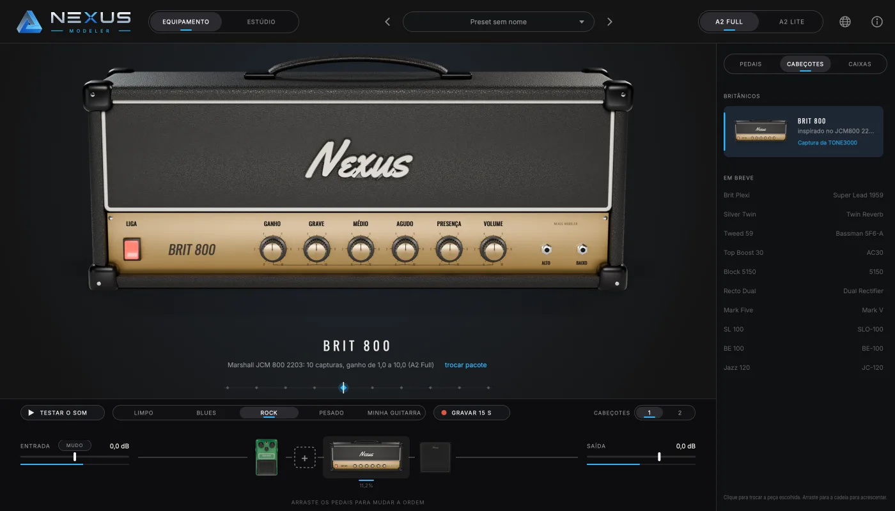
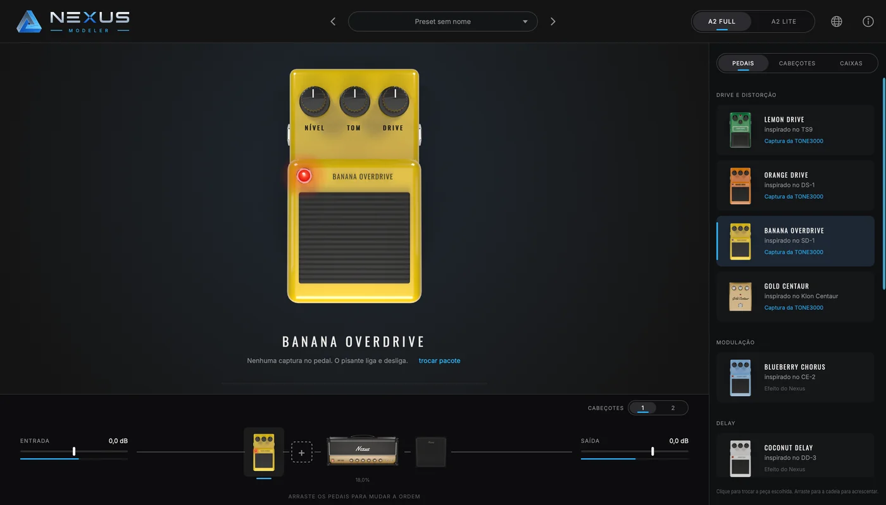
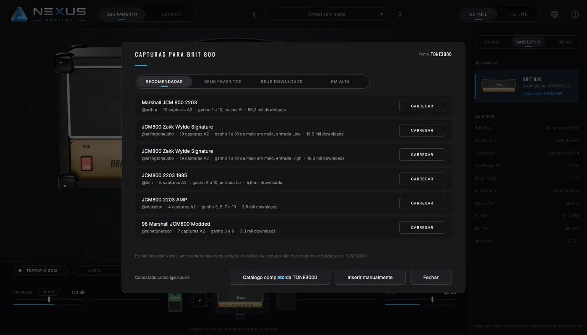
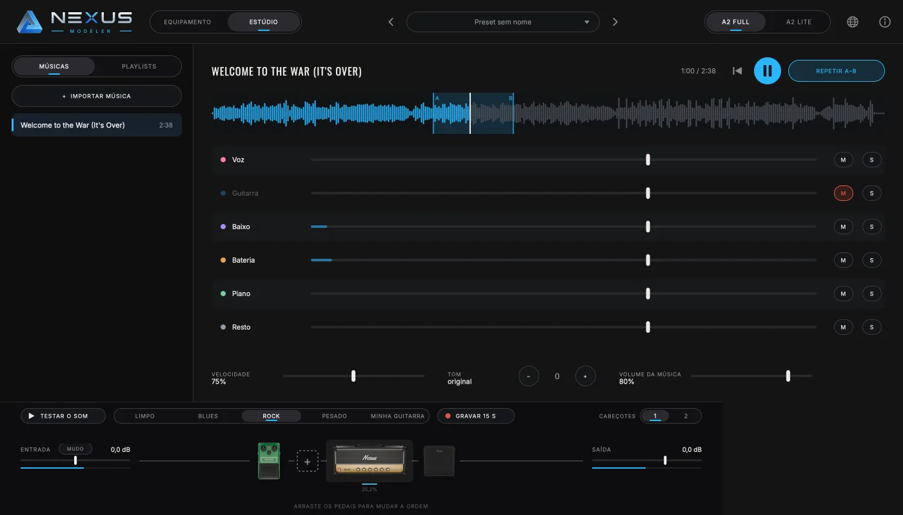

# Nexus Modeler

**A qualidade da captura com a facilidade da modelagem.**

Plugin de guitarra gratuito e de código aberto para Windows, Mac e Linux.

Site do projeto: https://disouz4-dev.github.io/Nexus-Modeler/

Hoje o guitarrista escolhe entre dois mundos:

- a **modelagem** de amplificador: você gira os botões e timbra à vontade, mas
  o som é uma simulação;
- a **captura**: o som real de um equipamento, mas congelado no ajuste em que
  foi gravado. Para mudar o timbre, você troca de arquivo.

O Nexus Modeler une os dois. Ele traz para o mundo da captura a facilidade de
timbragem da modelagem, sem abrir mão da qualidade que a captura tem.

Na prática:

- **O botão troca a captura.** Quem clona um amplificador publica um pacote
  com várias capturas (ganho 0, 1, 2… até 10). No Nexus, você gira o ganho do
  cabeçote, ou o drive do pedal, e ele carrega a captura daquela posição por
  dentro, sem clique no som e sem abrir pasta nenhuma.
- **O equalizador do painel funciona como no amplificador real.** Ele é
  modelado no circuito de tonalidade de cada família de amplificador e aplica
  só a diferença para a posição em que a captura foi feita. Com os botões
  nessa posição, o som é exatamente o da captura.
- **Canais, pedais e caixa como num equipamento de verdade.** Um cabeçote de
  até 3 canais, como o original, com uma captura por canal. Pedais com drive
  em estágios, que também trocam de captura. A caixa respeita a captura full
  rig.

Tudo isso toca capturas do
[Neural Amp Modeler](https://github.com/sdatkinson/NeuralAmpModelerCore)
(NAM A2 Full e A2 Lite).

> **Estado atual: em desenvolvimento, ainda sem versão publicada.** Já
> funcionam o motor de troca de capturas, a tela 3D com o cabeçote Brit 800,
> a caixa 4x12 e sete pedais, a cadeia completa com dois cabeçotes, as
> capturas da TONE3000 dentro do programa, presets, MIDI, 15 idiomas, os
> instaladores, a atualização automática, o "Testar o som" com gravações de
> guitarra por estilo, o relatório de problemas para o GitHub e a primeira
> versão do estúdio (separar as faixas de uma música e tocar junto). Lista
> completa de equipamentos em
> [docs/CATALOGO.md](docs/CATALOGO.md).



*O cabeçote Brit 800: com o ganho entre duas posições, as duas capturas
vizinhas tocam juntas (os losangos acesos no trilho embaixo do nome). À
direita, a coluna dos equipamentos; embaixo, o caminho do sinal.*



*Pedal Banana Overdrive: o drive troca de captura como o ganho do cabeçote; o
pisante liga e desliga e só o LED acende.*



*Capturas da TONE3000 para o equipamento escolhido, sem sair do Nexus. Com a
conta conectada, "Carregar" baixa direto para Documentos/Nexus Modeler.*


*Dois cabeçotes, cada um com pedais e caixa próprios, trocados por um pedal
A/B sem estalo.*



*O estúdio: a música separada em voz, guitarra, baixo, bateria, piano e o
resto. Aqui a guitarra está no mudo (para tocar no lugar dela), a música está
a 75% e o trecho A–B se repete. O caminho do sinal continua embaixo: a sua
guitarra passa pela cadeia e se mistura com a música.*

## O que já funciona

- **Troca de captura sem clique.** A captura que vai entrar primeiro "aquece"
  ouvindo o som recente da guitarra e só depois entra numa transição de 30 ms.
- **Mão no botão, capturas prontas.** Quando você pega um botão (antes de
  girar), as capturas vizinhas, até duas de cada lado, começam a aquecer; o
  giro entra na captura nova sem esperar os 132 ms de aquecimento de uma A2.
  Ao soltar, elas voltam a descansar para poupar o processador.
- **Testar o som:** em cima da entrada, toca uma gravação de guitarra limpa
  (direto na interface, sem amplificador) pela cadeia inteira, sem precisar
  tocar: Limpo, Blues, Rock e Pesado, ou "Gravar 15 s" da sua guitarra.
- **Entrada no mudo:** botão "Mudo" ao lado da entrada, e o controle todo para
  baixo também corta de vez (para o microfone do notebook não apitar com os
  alto-falantes). O "Testar o som" continua tocando com a entrada no mudo.
- **Botão contínuo ou em degraus.** Contínuo mistura as vizinhas; em degraus,
  o botão só para nas posições que têm captura.
- **Equalizador do painel** (grave, médio, agudo e presença) modelado no
  circuito de tonalidade do amplificador real. Ele aplica só a diferença entre
  a posição em que a captura foi feita e a posição escolhida. Com os botões na
  posição da captura, o som é exatamente o da captura.
- **A2 Full e A2 Lite** com um botão (o mesmo arquivo serve para os dois).
- **Qualquer taxa de amostragem.** As capturas rodam a 48 kHz; se o programa de
  gravação estiver em 44,1 ou 96 kHz, o plugin converte na entrada e na saída.
- **Formatos:** VST3 (Windows, Mac e Linux), AU (Mac), LV2 (Linux) e programa
  independente, sem precisar de programa de gravação.
- **Caixa (IR):** abas Desligada / Captura / IR próprio. "Escolher IR" abre os
  IRs da TONE3000 (recomendadas para a 4x12, favoritos, downloads e o catálogo
  completo); o pacote vem inteiro para Documentos/Nexus Modeler/Brit 4x12 e
  "trocar IR" lista os microfones e posições do pacote. Também aceita um `.wav`
  do computador. A troca entra e sai em 30 ms, sem estalo. Se a captura
  inclui a caixa (o `.nam` diz `amp_cab`, ou o `pack.json` traz
  `"inclui_caixa": true`), a caixa se tranca em "Captura".
- **Pedais:** até 12, cada um tocando captura NAM de pedal (pacote de drive
  com troca sem clique). Drive em degraus de 0 a 10, Tom e Nível livres; clique
  no pisante liga e desliga em 20 ms, sem estalo, com o LED vermelho aceso
  quando ligado. Pedais de captura: Lemon Drive (inspirado no TS9), Orange
  Drive (DS-1), Banana Overdrive (SD-1) e Gold Centaur (Klon). Efeitos do
  próprio Nexus: Blueberry Chorus, Coconut Delay e Grape Reverb, com rastro
  ao desligar.
- **Coluna de equipamentos** à direita: clique troca a peça escolhida,
  arrastar para a cadeia acrescenta. Lista completa, com os planejados, em
  [docs/CATALOGO.md](docs/CATALOGO.md).
- **Presets:** o som inteiro num arquivo, com anterior e próximo na barra de
  cima.
- **Uso do processador** de cada pedal e cabeçote, embaixo de cada peça.
- **Cadeia de sinal por clique e arrasta:** pedais antes do cabeçote, entre o
  cabeçote e a caixa (modulação, por exemplo) ou depois da caixa. Dois
  cabeçotes com pedal A/B: cada lado com cabeçote, pedais e caixa próprios, e
  troca de lado sem estalo.
- **Capturas da TONE3000 dentro do Nexus:** "abrir pacote" mostra as capturas
  recomendadas para aquele equipamento, os favoritos e downloads da sua conta
  filtrados por ele, as em alta e o catálogo completo, sempre com a TONE3000
  como fonte e o nome de cada criador. O Nexus baixa direto só as capturas
  certas, uma por posição do botão, e monta o pacote em Documentos. "Inserir
  manualmente" aceita pasta, `.zip` ou capturas soltas, com mapeamento.
- **Atualização automática:** o aviso de versão nova aparece no topo; um
  clique baixa e abre o instalador do seu sistema.
- **Programa independente com interfaces de áudio de baixa latência:** ASIO,
  WASAPI e DirectSound no Windows, Core Audio no Mac, JACK e ALSA no Linux.
  O painel de áudio (ícone da interface na barra de cima) escolhe interface,
  entrada da guitarra, saídas, taxa e buffer, e mostra a latência de ida e
  volta, o uso do processador e o sinal da guitarra.
- **MIDI por USB e Bluetooth:** troca de patch 1, 2, 3 escolhe o canal do
  cabeçote; qualquer controle da pedaleira (CC) pode ser ligado a qualquer
  botão, ao pisante do pedal ou ao canal: clique com o botão direito e
  "Aprender MIDI". No programa independente os dispositivos MIDI abrem
  sozinhos; no Mac há um botão para parear MIDI por Bluetooth; no Windows e no
  Linux, pareie nos ajustes de Bluetooth do sistema.
- **Cabeçote de até 3 canais, como o original:** cada canal tem o próprio
  pacote de capturas e o próprio ganho; a troca é sem estalo e o canal parado
  não gasta processador. Amplificador de um canal (o Brit 800) não mostra
  seletor.
- **15 idiomas:** português (Brasil), inglês, espanhol, francês, italiano,
  alemão, japonês, chinês, coreano, hindi, árabe, bengali, russo, indonésio e
  turco. O globo na barra de cima troca o idioma; na primeira vez vale o do
  sistema. Os nomes dos botões (GANHO, GRAVE…) são caixas de texto por cima da
  imagem 3D, traduzidas sem precisar renderizar de novo. O pacote de idiomas
  fica em `assets/idiomas/` e é gerado por `tools/idiomas/traducoes.py`.
- **Tela 3D:** amplificador, caixa e pedais modelados e renderizados pelo Nexus Gear
  Studio (`tools/gear_studio`). Cada botão tem 101 imagens: arraste para cima
  ou para baixo, Shift para ajuste fino, duplo clique volta ao padrão.
- **Estúdio:** a chave "Equipamento | Estúdio" no alto troca a tela. Importe
  uma música (MP3, WAV, FLAC, M4A, ou arraste o arquivo) e o Nexus separa voz,
  guitarra, baixo, bateria, piano e o resto (Demucs de 6 faixas, no próprio
  computador; o modelo de 55 MB é baixado na primeira vez). Cada faixa tem
  volume, mudo e solo; a música toca com velocidade de 50 a 100% sem mudar o
  tom, tom de −6 a +6 semitons sem mudar a velocidade e repetição de um
  trecho (arraste na forma da música para marcar A–B). Playlists tocam uma
  música atrás da outra. O caminho do sinal continua embaixo: a sua guitarra
  passa pela cadeia e se mistura com a música. Tudo fica em
  `Documentos/Nexus Modeler/Estúdio`; a mesma música não é separada duas
  vezes. Hoje a separação usa só o processador (num Mac Intel de 8 núcleos,
  cerca de 3 vezes a duração da música).
- **Reportar um problema:** no menu "i", o Nexus abre uma issue nova no
  GitHub já preenchida (versão, sistema e os últimos erros do registro); é só
  conferir e enviar. Se o programa independente fechar sozinho, na abertura
  seguinte ele oferece mandar o relatório do travamento. Nada de senha, chave
  ou nome de usuário vai junto. O registro fica em `registro.txt`, na pasta de
  ajustes do Nexus.

## Medidas

A ferramenta `nexus_bench` prova o motor com números, e `nexus_host_test` abre
o plugin compilado como um programa de gravação faria. Resultado num Mac Intel
Core i9 (2019):

| Verificação | Resultado |
|---|---|
| Fórmula do equalizador contra a análise do circuito (Marshall, Fender, alto ganho) | diferença máxima 0,000 dB |
| Equalizador na posição da captura | saída idêntica à entrada |
| Capturas iguais com o botão andando, comparadas a uma captura parada | diferença −311 dB (zero na prática): o aquecimento não deixa resto |
| Clique na troca (varredura, saltos, vaivém rápido, degraus) | nenhum excesso de aspereza; a troca seca, para comparação, dá +8,6 dB |
| Clique ao saltar grave, médio, agudo e presença de 0 a 10 | nenhum |
| Memória reservada durante o áudio | zero |
| Uso do processador por captura A2 Full / A2 Lite | 9,3 % / 1,4 % de um núcleo |
| Bloco de 128 amostras varrendo o ganho (3 capturas ativas) | 1,3 ms dos 2,7 ms disponíveis |
| Plugin aberto a 44,1, 48 e 96 kHz | carrega, toca e mantém o volume (diferença até 0,31 dB) |
| Captura full rig com IR ligado | o som não muda (diferença −300 dB): caixa trancada |
| Captura de cabeçote com IR | o IR muda o som, como deve |
| Pedal desligado | som idêntico ao de sem pedal (−300 dB) |
| Desligar o pedal tocando | sem salto no som (transição de 20 ms) |
| Tela: arrastar, Shift, duplo clique, trocar de peça, pisante | testado simulando o mouse |
| Interface de áudio real (Realtek USB, Mac) a 48 kHz | zero falhas de áudio; ida e volta 6,5 ms (32 amostras), 7,8 ms (64), 10,5 ms (128) |
| Trocar de canal tocando | sem salto; canal vazio é ignorado |
| MIDI: troca de patch, aprender CC, liga/desliga, salvar | tudo confere |
| Validador de plugins (pluginval, nível 5) | roda na compilação automática nos três sistemas |

## Como carregar capturas

1. Escolha o equipamento (cabeçote ou pedal) e clique em **abrir pacote**,
   embaixo do nome.
2. A janela mostra as capturas da TONE3000 para aquele equipamento:
   recomendadas, seus favoritos, seus downloads e as em alta. Entre com a sua
   conta da TONE3000 uma vez; depois, **Carregar** baixa direto.
3. Tudo fica em `Documentos/Nexus Modeler/<equipamento>/<pacote>`.
4. **Inserir manualmente** aceita uma pasta, um `.zip` ou capturas `.nam`
   soltas; o Nexus copia ou descompacta para a pasta do equipamento.

O Nexus descobre sozinho a posição do botão de cada captura pelo nome
(`Ganho 7.nam`, `JCM800 G7.nam`, `drive_7.5.nam`…). Quando não consegue (nome
sem número ou duas capturas na mesma posição), abre a tela **Mapear as
capturas** para você dizer a posição de cada uma. O resultado fica num
`pack.json` na pasta, que também pode ser escrito à mão:

```json
{
  "nome": "Brit 800",
  "botao": "Ganho",
  "circuito": "marshall",
  "equalizador_da_captura": { "grave": 5, "medio": 5, "agudo": 5, "presenca": 5 },
  "capturas": { "0": "ganho0.nam", "5": "ganho5.nam", "10": "ganho10.nam" }
}
```

Circuitos de equalizador disponíveis: `marshall`, `fender`, `alto_ganho`,
`mesa_mark`.

## Como instalar

Pelo site, cada sistema tem o botão do instalador e o comando do terminal:
https://disouz4-dev.github.io/Nexus-Modeler/#sistemas

Os instaladores ficam na página de
[lançamentos](https://github.com/disouz4-dev/Nexus-Modeler/releases/latest)
(a primeira versão ainda não foi publicada). Depois de instalado, o Nexus
avisa sozinho quando sai uma versão nova e instala com um clique.

### Windows

Instalador: `NexusModeler-<versão>-Windows-instalador.exe`. Instala o VST3 e
o programa independente, com atalho no menu Iniciar, e pergunta o idioma.

Pelo terminal (PowerShell, sem administrador; o VST3 vai para a pasta VST3 do
usuário):

```powershell
irm https://raw.githubusercontent.com/disouz4-dev/Nexus-Modeler/main/packaging/instalar.ps1 | iex
```

### Mac

Instalador: `NexusModeler-<versão>-Mac.dmg`. Abra o `.dmg` e depois
**Instalar Nexus Modeler.pkg**; em **Tipo de instalação**, escolha VST3, AU
e/ou o programa independente. Enquanto o instalador não for assinado pela
Apple, abra com o botão direito e **Abrir** na primeira vez.

Pelo terminal (sem administrador; plugins em `~/Library/Audio/Plug-Ins` e o
programa em `~/Applications`):

```bash
curl -fsSL https://raw.githubusercontent.com/disouz4-dev/Nexus-Modeler/main/packaging/instalar.sh | bash
```

### Linux

Instalador para Debian, Ubuntu e derivados: `NexusModeler-<versão>-Linux-amd64.deb`
(`sudo apt install ./NexusModeler-<versão>-Linux-amd64.deb`). Instala o VST3
em `/usr/lib/vst3`, o LV2 em `/usr/lib/lv2` e o programa `nexus-modeler`, com
atalho no menu.

Pelo terminal, em qualquer distribuição (sem administrador; `~/.vst3`,
`~/.lv2` e `~/.local/bin`):

```bash
curl -fsSL https://raw.githubusercontent.com/disouz4-dev/Nexus-Modeler/main/packaging/instalar.sh | bash
```

Os comandos do terminal perguntam o idioma (ou use `--idioma pt-BR`, por
exemplo). Os pacotes são gerados pelo fluxo `.github/workflows/pacotes.yml`
(scripts em `packaging/`).

## Como compilar

Precisa de CMake 3.24 ou mais novo, Git, Python 3 e um compilador C++20
(Xcode no Mac, Visual Studio 2022 no Windows, GCC ou Clang no Linux). O JUCE é
baixado sozinho na primeira configuração.

```bash
git clone --recursive https://github.com/disouz4-dev/Nexus-Modeler.git
```

```bash
cmake -S Nexus-Modeler -B Nexus-Modeler/build -DCMAKE_BUILD_TYPE=Release
```

```bash
cmake --build Nexus-Modeler/build --config Release
```

```bash
ctest --test-dir Nexus-Modeler/build -C Release --output-on-failure
```

Os plugins ficam em `build/plugin/NexusModeler_artefacts/Release/`. No Linux,
instale antes as bibliotecas de desenvolvimento listadas em
`.github/workflows/compilacao.yml`.

Para a janela de capturas falar com a TONE3000, a compilação precisa da chave
pública do projeto na TONE3000: acrescente `-DNEXUS_T3K_KEY=<chave>` na
configuração (ou defina a variável de ambiente `NEXUS_T3K_KEY` antes de abrir
o programa). Sem a chave, o Nexus funciona igual, com pacotes do computador.

A cada envio ao GitHub, a compilação automática gera e testa o plugin nos três
sistemas e guarda os arquivos compilados na aba **Actions**.

## Organização

```
engine/     motor: troca de capturas, equalizadores, leitura dos pacotes
plugin/     plugin JUCE (tela e caixa) e testes do plugin aberto
tools/      medidor do motor, pacotes de teste, Nexus Gear Studio (3D) e a marca
assets/     imagens 3D renderizadas, marca, fontes e idiomas, embutidos no plugin
external/   motor oficial do NAM (submódulo)
docs/       site, catálogo, imagens e o plano dos modelos 3D
```

## Novidades

O que mudou em cada versão está em [NOTAS-DE-VERSAO.md](NOTAS-DE-VERSAO.md).

## Licença

Nexus Modeler é software livre sob a licença **GPL versão 3** (veja
[LICENSE](LICENSE)). Os componentes de terceiros e as licenças deles estão em
[TERCEIROS.md](TERCEIROS.md).

Os nomes de marcas de amplificadores citados neste repositório pertencem aos
seus donos e aparecem só como referência. O Nexus Modeler não tem ligação com
eles.
